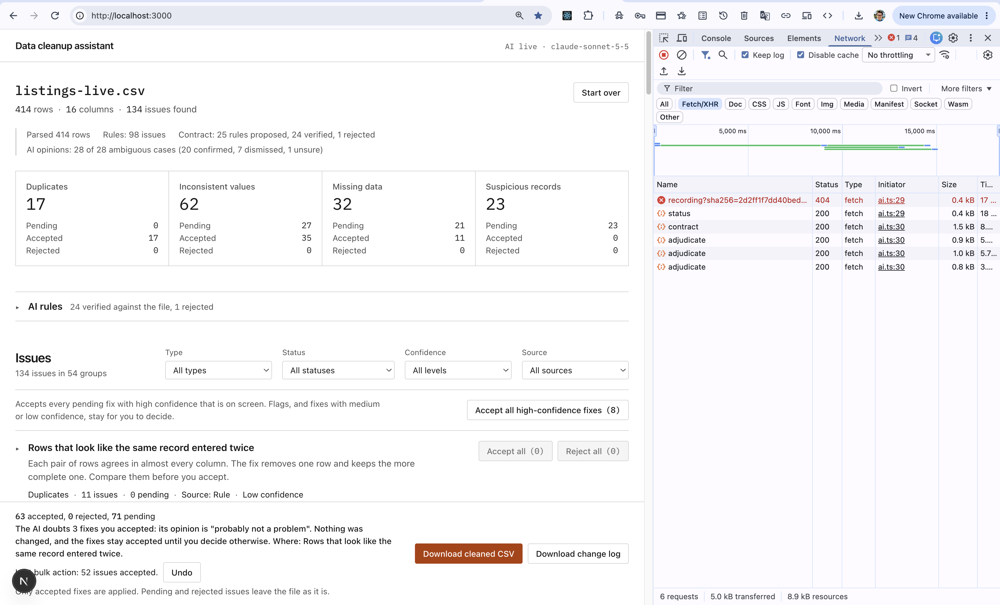
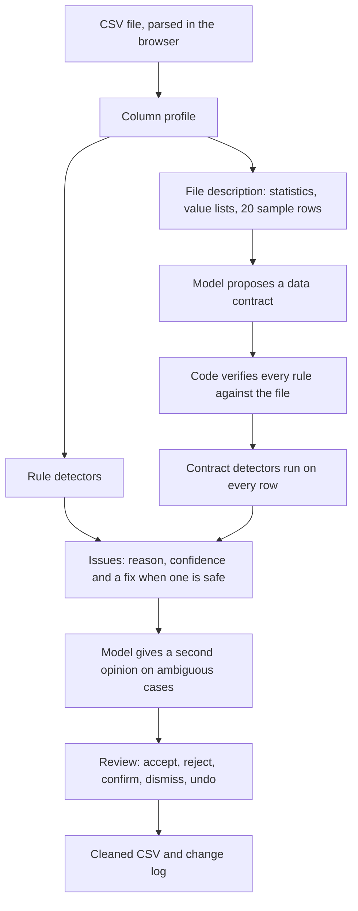

# AI Data Cleanup Assistant

Upload a CSV, see what is wrong with it, review every suggested edit with the reason behind it,
and download a cleaned file plus a record of what changed.

Built in one day for the One Day Build challenge (Project 4, "AI data cleanup assistant").

**AI proposes, code verifies, the human decides.** The model never edits data. It proposes
rules about the file, code checks each rule against the data before using it, and nothing
changes until the user accepts it.



## What it does

- Finds the four kinds of problem the brief names: duplicates, inconsistent values, missing
  data and suspicious records.
- Shows each problem with the cell before and after, a reason in plain words, a confidence
  level and its source (a rule, or a rule proposed by the AI).
- Lets you accept or reject each fix, alone or by group, accept every high-confidence fix at
  once, and undo the last bulk action. Problems with no safe fix can be confirmed or dismissed.
- Exports the cleaned CSV and a change log that lists every issue with your decision. The
  original file is never modified.
- Works without an API key: the bundled sample ships with a recorded AI analysis, and any
  other file gets the rule-based analysis.

## Run it

Node 22 was used to build it.

```bash
npm install
npm run dev
```

Open http://localhost:3000 and press "Use sample data". No key is needed for that.

To analyse your own files with AI, copy `.env.example` to `.env.local`, put an Anthropic API
key in it and restart. One full analysis of the sample cost about 0.10 USD (see the numbers
below).

Other commands:

| Command | What it does |
|---|---|
| `npm test` | Unit and component tests |
| `npm run eval` | Scores the rule detectors on the development dataset. No key needed |
| `npm run eval:recorded` | Scores rules plus the recorded AI responses. No key needed |
| `npm run eval:live` | Same with fresh model calls. Needs a key, writes the recording |
| `npm run eval:heldout` | Scores the held-out dataset with fresh model calls. Needs a key. I ran it once, at the freeze |
| `npm run typecheck`, `npm run lint`, `npm run build` | The usual checks |

Limits: 10 MB, 50,000 rows, 100 columns, UTF-8.

## How it works



**Rules first.** Exact duplicates, probable duplicates, empty cells, placeholder words, case
and spacing variants, formatted numbers, mixed date formats and statistical outliers are
found by plain code. This result appears at once and exists even if every AI call fails.

**The model reads a description of the file, not the file.** It receives column statistics,
the values of each column with their counts (capped) and 20 sample rows. For the 88 KB sample
that description is 32 KB, and it stops growing with the number of rows. It returns a data
contract: which values mean the same thing, which words mean "no value" in a column, which
values look like test data, what range a column can take, and which column determines another.

**Code checks every proposed rule before using it.** A value the model names must exist in the
file. A dependency must hold in at least 95% of the rows. A range must contain at least 95% of
the values. A rule that fails is rejected and shown with the reason. In the first live run the
model proposed that `listing_id` determines `address`; the data rejected it. The spelling to
keep is chosen by code (the one the file uses most), not by the model.

**Fixes never invent values.** A fix writes the empty string, a value that already exists in
the same column, or a reformatting of the cell's own value. A missing city is filled only when
the other rows with the same zip agree on it. Where the right value cannot be known from the
file, the problem is flagged and nothing is proposed.

**A second opinion for what rules cannot settle.** A rule cannot tell a luxury home from a
price typo, or unit 4A from unit 4B. Those cases go to the model with the full rows. Its
answer only changes how prominent the issue is: a dismissed issue moves to its own section,
out of the counts and the bulk actions, and one click restores it. A verdict never creates or
changes a fix.

**Privacy.** The file is parsed in the browser. The server stores nothing and my code logs no
payload: the model client is created with logging off. What reaches the model is the
description above and the rows of at most 60 ambiguous cases. With no key, no file content
leaves the browser: only the file's SHA-256 is sent, to look up a recording. One point about
the SDK is not verified; it is item 4 of the open findings below.

The contract, with every constant and threshold, is in [SPEC.md](SPEC.md).

## Does it work? The measured numbers

Before any detector existed I committed two synthetic datasets with planted errors and their
ground truth, and a SPEC that fixes how a result is scored and the thresholds the build had to
meet (SPEC §8). The development dataset has 414 rows with 130 planted errors and 8 traps: rows
that look wrong but are right.

| Development dataset | Rules only | Rules + AI contract | + AI second opinion |
|---|---|---|---|
| Planted errors found | 105 of 130 | 130 of 130 | 130 of 130 |
| False positives | 7 | 7 | 0 |
| Precision | 0.938 | 0.949 | 1.000 |
| Recall | 0.808 | 1.000 | 1.000 |
| Correct fixes | 49 of 49 | 84 of 84 | 84 of 84 |
| Invented values | 0 | 0 | 0 |
| Fixes proposed on clean data | 3 | 3 | 0 |

Every run is committed under `evals/runs/`, including the first live run, where one threshold
failed (3 fixes on clean data against a limit of 2) until the second opinion was built.

Cost and time of one full analysis of the sample, measured: 4 model calls, 31,731 input tokens
and 3,380 output tokens, about 16 seconds, about 0.10 USD at the prices published for
`claude-sonnet-5-5` on 2026-11-23.

### Why you should not trust the perfect score

- The development dataset and the rules have the same author. Finding everything that was
  planted there proves little.
- The prompt for the second opinion was written after reading the notes of the development
  traps, so its result on that dataset is optimistic.
- One rule (skip the outlier check on a column where more than 5% of the values fall outside
  the fences) was added after the development data showed valid zip codes being flagged.
- The data is synthetic. None of this measures performance on real files.
- The table is one recorded run and the model is not deterministic. In three live runs with the
  second opinion, the contract had 24 or 25 verified rules and one opinion changed from
  "confirmed" to "unsure". The issue counts per type came out the same each time.

### The held-out result

That is why there is a second dataset from another domain: sales contacts, 310 rows, 99
planted errors and 4 traps. I did not open it while building. I scored it once, at the commit
tagged `freeze`, and changed no code, prompt or threshold because of the result. After the
freeze I restyled the interface (session 6). The code that produced this score did not change:
`git diff --stat freeze -- src/core src/ai src/app/api src/lib fixtures scripts package.json package-lock.json`
prints nothing.

| | Development, recorded run | Held-out, scored once | Threshold (SPEC §8.4) | Held-out against it |
|---|---|---|---|---|
| Planted errors found | 130 of 130 | 86 of 99 | | |
| False positives | 0 | 11 | | |
| Precision | 1.000 | 0.887 | 0.90 or more | Fails |
| Recall | 1.000 | 0.869 | 0.80 or more | Passes |
| Correct fixes | 84 of 84 | 63 of 63 | 0.95 or more | Passes |
| Invented values | 0 | 0 | 0 | Passes |
| Fixes proposed on clean data | 0 | 4 | 2 or fewer | Fails |

The thresholds were set for the development dataset. The held-out run is report-only, so they
are here for comparison. The run file is `evals/runs/20261124T002953Z-heldout-contacts.json`:
2 model calls, 17,283 input tokens and 1,525 output tokens.

**What it missed.** The 13 missed errors are in 4 of the 17 kinds of planted error.

- **Re-entered records: 0 of 6 found.** The rule reports pairs that are at least 90% similar.
  These copies have a new id, a shortened or misspelled name and a different note, and they
  score 82 to 84%. On the development data the planted pairs scored 93 to 97%, so the
  threshold fit the one file I had seen. The 4 exact duplicates were all found.
- **Invalid emails: 0 of 4 found.** The model marked the column as emails and my code verified
  the rule, but I had cut the detector that uses format rules. The kind has 6 errors; the 2
  that were found are a state code and a phone number, caught by other rules.
- **Number typos: 3 of 5 found.** The two that were missed are revenue values 100 and 1,000
  times too large. The rule "the company decides the revenue" needs 80% of a company's rows to
  agree. Another row of that company held "$390,000,000", and the rule compared it as text and
  counted it as one more different value: 8 of 11 rows agreed (73%). Read as a number it is 9
  of 11 (82%), and both typos would have been reported.
- **Impossible values: 3 of 4 found.** The one that was missed is a signup date in 2031. The
  model proposed a range with a lower bound and no upper bound, and nothing in my code knows
  today's date.

**The false positives.** All 11 are on the six copies that the duplicate rule missed. 4 are
fixes that rewrite the misspelled name of a copy to the spelling of its original ("Dieg" to
"Diego"); they are the 4 fixes on clean data. 7 are flags: two shortened names, and an import
note that only the copies carry, on five rows. The AI's rules found the traces of the copies
cell by cell while the duplicate rule missed the rows. My scoring rules count an issue on a
cell of a copy as a false positive, and I report the number as it came out. The 4 name fixes
would be a risk on real data in any case: they rewrite a person's name because a similar name
is more common in the file.

**What held.** Every fix proposed for a planted error was correct (63 of 63), no value was
invented and no trap was reported. The second opinion judged one case in this file and
confirmed it. It had no duplicate to judge, because the rule reported no candidate.

The analysis of each group, with the rows and the numbers, is in [DECISIONS.md](DECISIONS.md)
(F70 to F74).

## How the ambiguous parts of the brief were decided

| The brief leaves open | Decision |
|---|---|
| What "use AI to read through the data" means when a file does not fit in a prompt | The model reads a compressed view and proposes rules; code applies them to every row |
| What counts as a duplicate | Exact copies, and probable same-record pairs that the AI confirms or dismisses. Rows are never merged |
| Missing data: fill it or flag it | Flag it. Propose a value only when other rows of the same file support it |
| What "suspicious" means | Unusual numbers, impossible values, broken formats and test data, always with a reason and never with an automatic fix |
| What "review/accept" requires | Nothing is accepted by default, the original is never modified, and every decision is exported |
| How a reviewer runs it without a key | A recorded AI analysis for the sample; rules for everything else |

All twelve decisions, with what was rejected and what it would cost to reverse each one, are
in [DECISIONS.md](DECISIONS.md).

## How it was built in one day

1. **Contract before code.** The first commit holds the SPEC, the decisions, the datasets with
   their ground truth and the thresholds. No application code.
2. **Four build sessions with gates.** Each one started from a written prompt (they are in
   [docs/prompts](docs/prompts)): the agent shows a plan and waits, builds, and reports against
   done criteria that were fixed before the run. The interface and the AI layer were built in
   parallel in two git worktrees and then merged. A fifth session fixed what the second review
   found, and a documents-only session logged the held-out run. A sixth session, after the
   freeze, restyled the interface and changed presentation only.
3. **Predictions before runs.** Before changing the outlier rule I wrote down the result I
   expected (112 issues, 105 found, 7 false positives). The run gave exactly that.
4. **Four independent reviews.** A separate agent with no context read the core: it found no
   blocker and several smaller problems, and eight fixes went in before anything was built on
   top. A second review, of the AI layer and the interface, found that a decision made while
   the AI was still answering could be lost. I fixed it, with tests, before the freeze. A third
   review, of those fixes, ran at the freeze and found the same loss through a narrower window,
   plus two smaller problems. I did not fix them: they are listed under Open findings. A fourth
   review, of the restyle, found three sentences on screen that could be false in rare states.
   I fixed them, and the reviewer checked the fixes before the merge.
5. **Findings instead of patches.** When the code and the SPEC disagreed, the disagreement was
   written down and decided between sessions. The SPEC went from 1.0 to 1.4 that way, and two
   of the findings were mistakes in my own SPEC. Version 1.5 only rewrites the two sentences
   about the interface that the restyle made false.

### How I used AI to build it

- Claude, as a design partner: the SPEC, the datasets and the session prompts were drafted
  with it and approved by me.
- Claude Code, for the implementation, in the gated sessions above.
- A second Claude Code agent, restricted to reading the diff, for the four independent
  reviews.
- What stayed with me: approving or changing every plan, deciding every finding, and every
  paid model call and every push. The API key never entered an agent session.

Stack: Next.js 16, TypeScript in strict mode, Tailwind CSS, Papa Parse, Zod, Vitest, Testing
Library and the Anthropic TypeScript SDK. No database.

## Known limits

- A single-column file cannot hold an empty cell: an empty line and an empty cell cannot be
  told apart, so that row is skipped.
- A file that is not UTF-8 is refused, with a message that says how to save it as UTF-8. A
  byte-order mark is not kept on export.
- Dates written in the less common order of a column (day first in a month-first column) are
  not flagged.
- Probable duplicates are found by comparing all columns. On a narrow table of numbers this
  pairs unrelated rows.
- The model sees a description and a sample. A problem that no rule describes and that is not
  in a value list or in the sample is not found.
- The change log does not record the AI's verdict on an issue.
- A decision is never replaced. If you decide on an issue and a later AI result proposes a
  different fix for that cell, the later proposal is not shown. If the AI doubts a fix you
  already accepted, the fix stays accepted and a notice says so. Item 3 of the open findings
  is a case where that notice goes away too early.
- The AI can propose format rules (for example, that a column holds emails). This version checks
  them against the file and does not use them to find issues.
- The restyled interface was checked by hand in a desktop-width window. At 779 and 1023 px
  wide it was checked only on screenshots taken by the build agent, and keyboard reach only by
  a test. The look of the "Run live" button was not checked in a browser after the restyle.
  Not tested with a screen reader or at phone widths.
- Analysis runs on the main thread. The rule-based pass over a generated file of 50,000 rows and
  12 columns (8 MB) took about 8 seconds, measured in Node, and the browser tab does not respond
  during that time. With AI on, the pass runs a second time when the contract arrives.
- The spelling a fix writes is chosen before extra spaces are tidied. In a column where the most
  common spelling carries a trailing space, the fix can write that space.
- The browser sets no time limit on its calls to the server. If a connection stalls, the progress
  line stays until the browser gives up; the rule-based result remains usable.

## Open findings

The third review ran at the freeze and returned "fix". I recorded what it found and did not fix
it, so these are open. The restyle that came later left this logic untouched. They are F75 to
F78 in [DECISIONS.md](DECISIONS.md). None of them was reproduced in a browser.

1. **Must fix: a decision clicked while a new AI result is being computed can be lost.** When
   the contract or a round of AI opinions arrives, the page computes the new analysis on the
   main thread. A click made during that time is handled afterwards, against the screen as it
   was. If the new analysis replaced the issue that was clicked, the decision is stored under
   an id that is no longer on screen: it is not counted, not applied and not logged, and
   nothing says so. It is the loss the second review found, through a narrower window. The
   window is the time the analysis blocks the tab, about 8 seconds at 50,000 rows.
2. **The bar can say "Decisions changed after a download" when no decision changed.** It
   happens when an AI result arrives after a download while a decided issue is being carried
   over.
3. **The notice about an accepted fix that the AI doubts goes away after "Run live"**, while
   the fix is still accepted.
4. **Not verified: two settings of the Anthropic SDK that are read from environment
   variables**, a logger for code that has no client and OpenTelemetry tracing. I did not check
   whether either could write rows of a file to a log or a trace if someone set those variables
   on the server.

## With another day

The order comes from the held-out result.

1. Duplicates: send the pairs below the 90% bar to the AI second opinion, which already exists,
   instead of trusting one threshold. The new bar has to come from more than the two files I
   have.
2. Switch on the format checks. The AI already proposes them and my code already verifies them.
3. Analysis in a Web Worker, so the tab stays responsive on large files.
4. Close the four open findings, the lost decision first.
5. Two rule fixes the held-out run points to: compare numbers as numbers in the rule "one
   column decides another", and give date ranges an upper bound.
6. Keep spelling fixes away from names and free text, where a rarer spelling is not an error.

After that: an AI pass over the rows themselves, for problems no rule describes; field-level
merge for duplicates; saved contracts per data source, to approve the rules once and reuse them
on the next export of the same feed; and hand edits in the review.

## Repository map

| Path | What is there |
|---|---|
| `SPEC.md`, `DECISIONS.md` | The contract, and the reasons and findings |
| `src/core` | Plain TypeScript, no framework: CSV, profile, detectors, contract verification, adjudication, applying decisions |
| `src/ai`, `src/app/api/ai` | The model calls, prompts, recordings and the four routes |
| `src/components`, `src/lib` | The page and its logic |
| `evals` | The scorer, the eval commands and every committed run, the held-out run included |
| `fixtures` | The datasets, their ground truth and the recorded AI responses |
| `scripts/generate-fixtures.mjs` | The seeded generator of the datasets |
| `docs/prompts` | The prompts of the build, fix and design sessions, and of the second, third and fourth reviews. The prompt of the first review was not kept |
